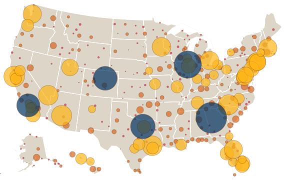
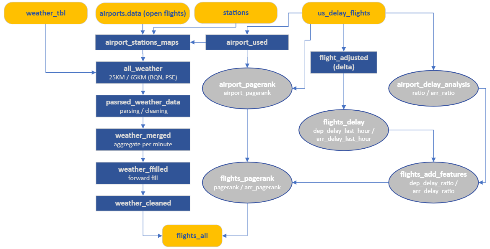
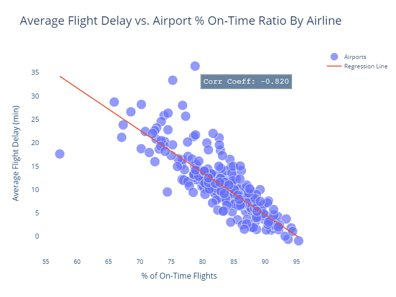

# Flight Delay Prediction at Scale

**An end-to-end machine learning pipeline for predicting U.S. flight delays**

<!-- Tech Stack -->


<!-- Project Info -->


---

## The Problem

Flight delays cost U.S. airlines over $25 billion annually and strand millions of passengers each year. But what if we could predict delays before they happen—giving airlines time to adjust operations and passengers time to rebook?

**The challenge:** Can we predict, at least two hours before departure, whether a flight will be delayed by 15+ minutes?

This isn't a simple classification problem. It requires:

- **Predicting before departure** — no cheating with in-flight data or arrival information
- **Operating at scale** — 31 million flight records spanning multiple years
- **Integrating heterogeneous data** — joining flight schedules with weather observations from 5,000+ weather stations

<p align="center">
  
</p>

---

## Our Approach

We built a complete pipeline that joins flight schedules with historical weather data and station metadata, engineers predictive features from these sources, then trains and evaluates multiple model architectures—from a baseline logistic regression to gradient-boosted trees and distributed neural networks.

### Pipeline

| Stage | Description |
|:------|:------------|
| **1. Data Integration** | Join 31M flight records with weather observations, mapping each airport to its nearest weather stations |
| **2. Feature Engineering** | Create temporal features (time of day, day of week), geographic features (origin/destination PageRank), carrier history, and weather conditions at both endpoints |
| **3. Baseline Model** | Hand-rolled logistic regression to establish a performance floor and validate our approach |
| **4. Production Models** | PySpark ML (Random Forest, GBT) with cross-validation; TensorFlow neural network with Horovod for distributed training |

<p align="center">
  
</p>

### Tech Stack

`PySpark ML` · `TensorFlow` · `Horovod` · `XGBoost` · `Azure Databricks` · `Koalas`

---

## Results

We evaluated models using an 80/10/10 temporal split (training on earlier flights, testing on later ones) to simulate real-world deployment. Given the class imbalance (~18% delayed flights), we optimized for F1 score rather than accuracy.

| Model | F1 Score | AUC | Notes |
|:------|:--------:|:---:|:------|
| Logistic Regression | 0.44 | 0.68 | Baseline with L2 regularization, optimized threshold |
| Random Forest | **0.50** | **0.71** | Best performance with top 6 features selected via importance |
| Neural Network | ~0.80 acc | — | 3-layer network with embeddings, distributed via Horovod* |

<sub>*Neural network accuracy approximate; trained on 10-node cluster with categorical embeddings</sub>

### What We Learned

The single most predictive feature was whether **the previous flight on the same aircraft was delayed**—a cascading effect that propagates through an airline's daily schedule. Departure time and origin-destination routing followed in importance. Weather features improved predictions modestly, but operational factors dominated.

<p align="center">
  
</p>

---

## Repository Structure

| Pipeline Stage | Notebook |
|:---------------|:---------|
| Data Integration & Features | [Preprocessing and Feature Engineering](notebooks/1.%20Preprocessing%20and%20Feature%20Engineering.ipynb) |
| Exploratory Analysis | [Flights EDA](notebooks/2.1%20EDA%20-%20Flights.ipynb) · [Weather EDA](notebooks/2.2%20EDA%20-%20Weather.ipynb) |
| Baseline Model | [Logistic Regression](notebooks/3.%20Toy_LR.ipynb) |
| Production Models | [PySpark ML](notebooks/4.%20Model%20Development%20with%20PySpark%20ML.ipynb) · [Neural Network](notebooks/5.%20FF_NN%20Pipeline.ipynb) |

---

## Interactive Documentation Site

We've built a data journalism-style scrollytelling website to showcase this project:

**[cbenge509.github.io/flightsontime](https://cbenge509.github.io/flightsontime)**

Features:
- Animated flight map visualization
- Interactive model comparison slider
- Scroll-triggered animations and EDA visualizations
- Fully responsive design

Built with Astro 5, Tailwind CSS v4, and TypeScript. See [`docs-site/`](docs-site/) for development details.

---

## Running Locally

Built for Azure Databricks. To explore the notebooks locally:

```bash
# Python 3.7.6
pip install -r requirements.txt
# or
pipenv install
```

---

<sub>**Team:** [Ning Li](https://www.linkedin.com/in/louisli/) · [Andrew Fogarty](https://www.linkedin.com/in/afogarty85/) · [Siduo Jiang](https://www.linkedin.com/in/siduojiang/) · [Cristopher Benge](https://cbenge509.github.io/) · UC Berkeley MIDS W261, Fall 2020</sub>

<sub>Licensed under MIT · See [LICENSE](LICENSE.txt)</sub>
